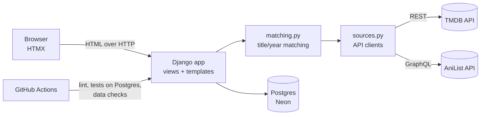

# CurtainCall

A personal tracker for films, series and anime in one library, with metadata pulled from
[TMDB](https://www.themoviedb.org/) and [AniList](https://anilist.co/).

**Live demo:** https://curtaincall-ybpj.onrender.com/library/ · **Code:** https://github.com/Skand007/CurtainCall

## Features

- **One library for everything:** films and series from TMDB, anime from AniList, with status
  (watched, watching, planned, dropped), half-star ratings, watch dates and notes.
- **CSV import with match review:** upload a list (the Letterboxd `Title,Year` format works as is).
  Each row is matched automatically when there is exactly one sensible candidate; remakes,
  typos and ambiguous titles wait in a review queue where you pick, search again or skip.
- **Search and add** from TMDB or AniList.
- **Public profile** with filters (type, live-action vs animated, status, title) and a
  **stats page**: hours watched, release decades, rating distribution, top genres, directors
  and anime studios.
- **Data quality checks** (`python manage.py check_data`) and a test suite, both run in CI.

## Architecture



- `tracker/sources.py` turns TMDB and AniList responses into one common "candidate" shape and
  caches titles in the database, so pages never call the APIs on load.
- `tracker/matching.py` decides whether a raw CSV row matches a candidate. `decide()` is a pure
  function (normalised titles, synonyms, ±1 year tolerance, fuzzy match only when the year agrees),
  which keeps it easy to unit-test.
- Imports run in small batches (10 rows per request) driven by HTMX, so no request comes near the
  host's timeout and an interrupted import resumes where it stopped.

### Data model

| Table | Holds |
|---|---|
| `Title` | One film, series or anime, unique on (`source`, `source_id`) |
| `Entry` | A title in a user's library; rating constrained to 0.5–5 in the database |
| `ImportBatch` / `ImportRow` | Uploaded files and the match state of each row |

## Running locally

```bash
python -m venv .venv && source .venv/bin/activate
pip install -r requirements-dev.txt
cp .env.example .env        # add your TMDB token
python manage.py migrate
python manage.py createsuperuser
python manage.py runserver
```

Without `DATABASE_URL` the app uses a local SQLite file.

## Tests and checks

```bash
pytest                       # 35 tests, all API calls mocked
ruff check . && ruff format --check .
python manage.py check_data  # data quality checks
```

CI runs all of these against Postgres 16 on every push.

## Deploying (Render + Neon)

1. Create a Postgres database on [Neon](https://neon.tech) and copy its connection string.
2. On [Render](https://render.com), choose **New → Blueprint** and select this repository.
   `render.yaml` defines the service.
3. Fill in the environment variables Render asks for: `DATABASE_URL`, `TMDB_TOKEN`,
   `DJANGO_ADMIN_USERNAME` and `DJANGO_ADMIN_PASSWORD`. The build creates that account.
4. After the first deploy, open `/import/` and upload your lists.

On Render's free plan the service sleeps after a period of inactivity, so the first visit can
take up to a minute.

## Useful commands

```bash
python manage.py refresh_metadata        # fetch missing genres/directors/runtimes
python manage.py refresh_metadata --all  # refresh every TMDB title
```

## Attribution

This product uses the TMDB API but is not endorsed or certified by TMDB. Anime data comes from AniList.
