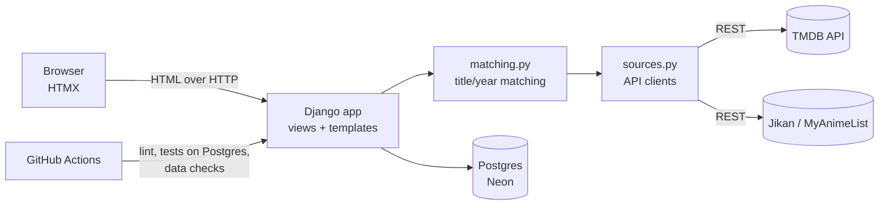

# CurtainCall

A personal tracker for films and series, live action and animated, in one library, with metadata
pulled from [TMDB](https://www.themoviedb.org/) and [MyAnimeList](https://myanimelist.net/) (through [Jikan](https://jikan.moe/)).


**Live site:** https://curtaincall-ybpj.onrender.com/

Film and series data from [TMDB](https://www.themoviedb.org/), Japanese animation from [MyAnimeList](https://myanimelist.net/) via [Jikan](https://jikan.moe/), IMDb ratings and Rotten Tomatoes critics' scores via [OMDb](https://www.omdbapi.com/).

## Features

- **One library for everything:** every title is a film or a series, live action or animated, with
  status (watched, watching, planned, dropped), half-star ratings, watch dates and private notes.
- **Click-through everywhere:** decade bars, score bands, genres, directors and studios on the stats
  page and on title pages open the library filtered to just those titles.
- **Backup:** one click downloads the whole library (status, ratings, dates, notes, ids) as a CSV
  that the importer can read back.
- **Link previews:** sharing the site or a title shows a card (Open Graph) with live numbers or the
  poster and rating.
- **Owner tools:** correct a title's type, style and studios (corrections survive refreshes),
  bulk-edit many titles at once, re-match a title to the right database entry without losing the
  rating, and run the refresh from the browser.
- **Public homepage:** visitors land on the library: the five latest posters fanned beside the
  heading (hover one to lift it), "Recently watched" and "Highest rated" shelves, and filters by type,
  style, genre and status.
- **Title pages:** full release date, IMDb rating, Rotten Tomatoes critics' score, worldwide box
  office, lead studios, cast with headshots (main characters and Japanese voices for MyAnimeList
  titles) and a trailer link.
- **CSV import with match review:** upload a list (the Letterboxd `Title,Year` format works as is).
  Each row is matched automatically when there is exactly one sensible candidate; if the full title
  finds nothing, a shorter search collects candidates. Remakes, typos and ambiguous titles wait in a
  review queue where you tick one or several matches, search again or skip. Every decision can be
  undone, and rows still unmatched download as a CSV.
- **Duplicate detection:** the same work from two sources (e.g. a Ghibli film in TMDB and MyAnimeList)
  is caught by shared IMDb/MyAnimeList ids or by name and year; adding a likely twin asks first,
  and a review page merges existing pairs while keeping ratings, dates and notes.
- **Stats:** hours watched, release decades, critics vs audience score distribution, top genres,
  directors and studios. Every chart has a table view.
- **Nightly refresh:** a scheduled GitHub Actions job calls a token-protected endpoint in small
  batches to fill missing details and scores, staying inside the OMDb free tier's daily limit.
- **Quality checks:** 107 tests with all APIs mocked, data-quality checks, linting, all in CI on Postgres.

## Architecture



- `tracker/sources.py` turns TMDB and MyAnimeList responses into one common "candidate" shape and
  caches titles in the database, so pages never call the APIs on load. Jikan allows 3 requests a
  second and 60 a minute, so its client paces itself.
- `tracker/matching.py` decides whether a raw CSV row matches a candidate. `decide()` is a pure
  function (normalised titles, synonyms, ±1 year tolerance, fuzzy match only when the year agrees),
  which keeps it easy to unit-test.
- Imports run in small batches (10 rows per request) driven by HTMX, so no request comes near the
  host's timeout and an interrupted import resumes where it stopped.

### Data model

| Table | Holds |
|---|---|
| `Title` | One film or series, unique on (`source`, `source_id`); `locked` lists fields set by hand |
| `Entry` | A title in a user's library; rating constrained to 0.5–5 in the database |
| `ImportBatch` / `ImportRow` | Uploaded files and the match state of each row |

## Running locally

```bash
python -m venv .venv && source .venv/bin/activate
pip install -r requirements-dev.txt
cp .env.example .env        # add your TMDB token
python manage.py migrate
python manage.py createsuperuser
python manage.py runserver
```

Without `DATABASE_URL` the app uses a local SQLite file.

## Tests and checks

```bash
pytest                       # 107 tests, all API calls mocked
ruff check . && ruff format --check .
python manage.py check_data  # data quality checks
```

CI runs all of these against Postgres 16 on every push.

## Deploying (Render + Neon)

1. Create a Postgres database on [Neon](https://neon.tech) and copy its connection string.
2. On [Render](https://render.com), choose **New → Blueprint** and select this repository.
   `render.yaml` defines the service.
3. Fill in the environment variables Render asks for: `DATABASE_URL`, `TMDB_TOKEN`, `OMDB_API_KEY`,
   `REFRESH_TOKEN`, `DJANGO_ADMIN_USERNAME` and `DJANGO_ADMIN_PASSWORD`. The build creates that account.
4. In the GitHub repository, add the secrets `SITE_URL` (the Render URL, no trailing slash) and
   `REFRESH_TOKEN` (the same value as on Render) so the nightly refresh can run.
5. After the first deploy, open `/import/` and upload your lists.

On Render's free plan the service sleeps after 15 idle minutes, so the first visit can take up to
a minute. A free uptime monitor requesting `/healthz` every 14 minutes keeps it awake; one service
running all month fits inside the free plan's 750 instance hours.

## Useful commands

```bash
python manage.py refresh_metadata        # fetch missing details from TMDB and MyAnimeList
python manage.py refresh_metadata --all  # refresh every title
```

## Attribution

This product uses the TMDB API but is not endorsed or certified by TMDB. Japanese animation data comes
from MyAnimeList through the unofficial Jikan API.
